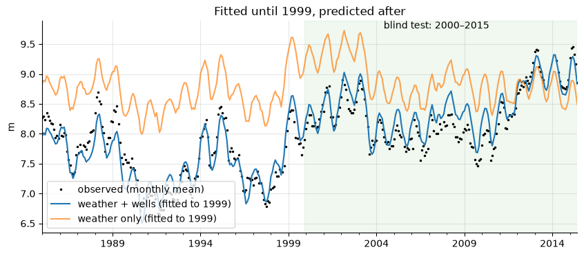

# KAI case studies on real data

**Water and energy models, tested in the open.** Before a KAI model runs on a client's borehole, sewer,
treatment plant or reservoir core, it is tested on real, openly licensed data. This repository publishes those tests as
step-by-step notebooks, with their data, so anyone can rerun them and check the results.

[**KAI Water & Energy**](https://kai-water.charkaks0.workers.dev/) · [**KAI Academy: all tutorials**](https://kai-water.charkaks0.workers.dev/academy.html) · [**Explore the cases on the KAI platform**](https://hydro-saas.charkaks0.workers.dev/explore) · [**Start free**](https://hydro-saas.charkaks0.workers.dev/portal?plan=hydrosaas:free) · [Contact](https://kai-water.charkaks0.workers.dev/contact.html)

| Case | Data from | Question | Notebooks | Key result | On the platform |
|---|---|---|---|---|---|
| [Boreholes: pumping tests, a borehole model and 55 years of levels](netherlands-boreholes/) | Netherlands | What is under the borehole, how far will it draw down, and is it the pumping or the weather? | [1 · pumping tests (TTim)](netherlands-boreholes/01_pumping_tests_ttim.ipynb) · [2 · MODFLOW 6](netherlands-boreholes/02_borehole_model_modflow6.ipynb) · [3 · Pastas](netherlands-boreholes/03_pumping_or_weather_pastas.ipynb) | Trained on 1960–1999, levels for 2000–2015 predicted to **0.22 m** RMSE of monthly means (weather alone: 0.77 m) | [Boreholes case](https://hydro-saas.charkaks0.workers.dev/demo/reference/boreholes) |
| [Pollution source tracing in a real sewer](denmark-bellinge-sewer/) | Denmark | Which manhole did the pollution come from? | [Tracer tests on the Bellinge network (EPA SWMM)](denmark-bellinge-sewer/01_source_tracing_bellinge.ipynb) | Right manhole named first in **58 %** of 53 blind releases with 5 sensors (random pick: 3 %) | [Bellinge case](https://hydro-saas.charkaks0.workers.dev/demo/reference/bellinge) |
| [Effluent BOD soft sensor](treatment-plant-soft-sensor/) | An urban treatment plant (UCI open data) | Can outlet BOD5 be known on the day instead of five days later? | [Soft sensor from a turbidity/TSS probe](treatment-plant-soft-sensor/01_bod_soft_sensor.ipynb) | Typical error **4.4 mg/L**, against 7.4 for the last lab result and 5.5 for the typical value; a 3-day failure flagged on the day, though its size was underestimated | [Soft-sensor case](https://hydro-saas.charkaks0.workers.dev/demo/reference/soft-sensor) |
| [Groningen Rotliegend core: rock typing, permeability from logs, REV and upscaling](netherlands-zeerijp-rotliegend/) | Netherlands (NLOG, well Zeerijp-3A) | Can rock types predict permeability, how well do logs do without core, and at what scale is permeability representative? | [1 · core QC and rock typing](netherlands-zeerijp-rotliegend/01_core_qc_rock_typing.ipynb) · [2 · permeability from logs, blind](netherlands-zeerijp-rotliegend/02_permeability_from_logs_blind_test.ipynb) · [3 · bedding, REV, upscaling](netherlands-zeerijp-rotliegend/03_bedding_rev_upscaling.ipynb) | Three rock types put **96 %** of 409 plugs within a factor of 3 (one trend: 77 %); logs alone, blind: **60 %**. Plugs show kv/kh ≈ 1, bed scale **0.003–0.05**; plugs cut in sandstone overstate vertical permeability **20–1,200×**. [Try it in the browser](https://kai-water.charkaks0.workers.dev/plug-to-block-lab) | [KAI-Subsurface](https://kai-water.charkaks0.workers.dev/kai-subsurface.html) |
| [Rhine–Meuse delta: facies between boreholes, tested blind](netherlands-rhine-meuse-heterogeneity/) | Netherlands (BRO boreholes, TNO GeoTOP) | What lies between boreholes, and how well can logs alone predict it? | [scripts](netherlands-rhine-meuse-heterogeneity/) | From-logs ensemble: **73 %** right facies on hidden boreholes; finds 48 % of hidden sand against 25 % for a nearest-borehole correlation. [Try it in the browser](https://kai-water.charkaks0.workers.dev/heterogeneity-lab) | [KAI-Subsurface](https://kai-water.charkaks0.workers.dev/kai-subsurface.html) |
| [River flow or rainfall: flood triggers from global data, tested on 14 river gauges](spain-guadalquivir-flood-triggers/) | Spain (CEDEX gauges, GloFAS, NASA POWER) | Can a global flood model set a parametric flood trigger where there is no gauge? | [Global model against the gauges](spain-guadalquivir-flood-triggers/01_global_model_flood_triggers.ipynb) | The model's 10-year flood is **22 %** of the gauged one; at 1-in-5 a trigger in m³/s caught **6 of 60** flood years, the same trigger as a return period **30 of 60** (27 false payouts). Set four ways on river flow and rainfall: one level for all sites pays in 0–78 % of years from gauge to gauge; storm rainfall caught **23 of 60**, the October–April total **31 of 60**. [Interactive case with a map](https://kai-water.charkaks0.workers.dev/case-guadalquivir) | [KAI-Hydro](https://kai-water.charkaks0.workers.dev/kai-hydro) |
| [Utah FORGE: hot granite for enhanced geothermal](usa-utah-forge-geothermal/) | USA (DOE Geothermal Data Repository) | Where is the hot granitoid, how hot is it, and what will a well pair deliver over 30 years? | [1 · structure and temperature](usa-utah-forge-geothermal/01_structure_and_temperature.ipynb), [2 · fractured granite](usa-utah-forge-geothermal/02_fractured_granite_ensemble.ipynb), [3 · 30 years](usa-utah-forge-geothermal/03_doublet_30_years.ipynb), [4 · checks and upscaling](usa-utah-forge-geothermal/04_upscaling_check.ipynb), [5 · decision chart](usa-utah-forge-geothermal/05_decision_chart.ipynb), [6 · phase 5 checks](usa-utah-forge-geothermal/06_phase5_checks.ipynb) | Granitoid **985 m** below ground at 58-32; temperature model within **1.7 °C** of the 2018 log. Calibrated on the 2024 circulation test, the model predicts its **93 %** recovery; only **10 kg/s** is pressure-feasible, cooling from **214 to 130 °C** in 30 years (P10–P90 116–148 °C; simulated). A test bed, not a power plant: a 30-year doublet would need about **320 m** spacing at 10 kg/s (surrogate). The temperature model is about **8 °C** hot at 16B, which explains most of the last produced-temperature misfit | [KAI-GeoEnergy](https://kai-water.charkaks0.workers.dev/kai-geoenergy.html) |



## What is in each case

Every case folder holds:

* a **README** with the question, the data and its licence, the method, the results and their limits;
* **notebooks** that run from top to bottom, with every figure and table already rendered on GitHub;
* `data/`: the real input files, unchanged, with their SHA-256 checksums (see [DATA.md](DATA.md));
* `results/kai_engine_results.json`: the KAI engine's own published results, the same file that powers
  the interactive page on the platform. The borehole and soft-sensor notebooks end by comparing their own answer
  with it; the Bellinge notebook reproduces the network and tracer physics and presents the engine's blind-test
  results, because the source search itself is part of the engine.

The notebooks use open tools only: [TTim](https://github.com/mbakker7/ttim), [MODFLOW 6](https://github.com/MODFLOW-ORG/modflow6)
through [FloPy](https://github.com/modflowpy/flopy), [Pastas](https://github.com/pastas/pastas) and
[EPA SWMM 5](https://github.com/USEPA/Stormwater-Management-Model) through
[swmm-toolkit](https://github.com/pyswmm/swmm-python), and [lasio](https://github.com/kinverarity1/lasio), scikit-learn and SciPy for the subsurface case. Where a result depends on KAI's own engine (the
probabilistic source search and sensor placement in the Bellinge case), the notebook shows the engine's
published results and says so; the engine itself is not part of this repository.

## Run them yourself

```bash
git clone https://github.com/Kaitale/kai-case-studies.git
cd kai-case-studies
python -m venv .venv && source .venv/bin/activate      # Windows: .venv\Scripts\activate
pip install -r requirements.txt
get-modflow :flopy --subset mf6                         # MODFLOW 6, for notebook 2 of the borehole case
jupyter lab
```

Python 3.11 or newer. Open a notebook from its own folder (the paths are relative to it). Each one runs in one
or two minutes on a laptop. A GitHub Actions workflow checks the data checksums and reruns every notebook each week
and on every change; the notebooks stop with an error if their key numbers drift from the published results.

## Part of KAI Academy

These notebooks are the free tutorials of [KAI Academy](https://kai-water.charkaks0.workers.dev/academy.html), grouped there into
learning tracks with their level and running time. New tutorials are added here as each KAI product launches; KAI Academy
also runs hands-on courses on your own data.

## Using KAI on your own data

These cases are the public test bench. On the platform, the same models run on a client's own data:

* [**HydroSaaS**](https://kai-water.charkaks0.workers.dev/hydrosaas.html): water intelligence for industrial parks and factories: water balance,
  pollutant loads and source tracing, borehole drawdown, effluent compliance (NEMA 2020).
* [**GroundWater Analyst**](https://kai-water.charkaks0.workers.dev/groundwater-analyst.html): 3D groundwater models from borehole records.
* [**KAI-Hydro**](https://kai-water.charkaks0.workers.dev/kai-hydro.html): parametric flood triggers tested against gauges, design floods, and flood and drought forecasts that end in a plain Normal, Watch or Warning.
* [**KAI-Subsurface**](https://kai-water.charkaks0.workers.dev/kai-subsurface.html): core and log interpretation, rock typing and permeability prediction.
* [**KAI-GeoEnergy**](https://kai-water.charkaks0.workers.dev/kai-geoenergy.html): geothermal, CO₂ and hydrogen storage models that keep the heterogeneity that matters.
* [All products and pricing](https://kai-water.charkaks0.workers.dev/pricing.html), each with a free tier.

## Licences and citation

* **Code** in the notebooks: [MIT](LICENSE).
* **Text, figures and KAI result files**: [CC BY 4.0](https://creativecommons.org/licenses/by/4.0/), © 2026 KAI Water & Energy.
* **Data** keep their own licences (MIT, BSD-2-Clause and CC BY 4.0; the Dutch NLOG files are fetched from NLOG, not copied here); sources, licences and checksums are listed in
  [DATA.md](DATA.md), and the upstream licence texts are in [LICENSES/](LICENSES/).
  Please cite the original data authors when you use the data.

To cite this repository, see [CITATION.cff](CITATION.cff).

*KAI Water & Energy, Kampala, Uganda. Water, foreseen.*
