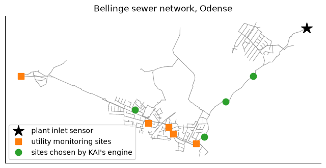
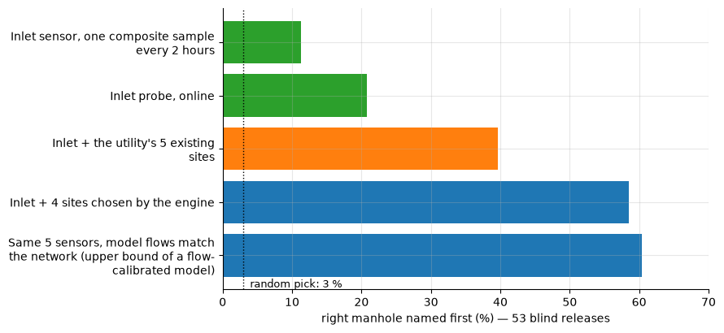

# Pollution source tracing on a real sewer: Bellinge, Denmark

[Interactive version on the KAI platform](https://hydro-saas.charkaks0.workers.dev/demo/reference/bellinge) · [Start free](https://hydro-saas.charkaks0.workers.dev/portal?plan=hydrosaas:free) · [All case studies](../README.md)

**Notebook:** [Which manhole did the pollution come from?](01_source_tracing_bellinge.ipynb)

When the inlet of a shared treatment plant spikes, every factory upstream says it was not them. This case shows,
on a real sewer network of about 1,000 manholes, what sensors can tell apart, and how well KAI's engine finds the
source of hidden releases from sensor data alone.

## Results of the blind test

53 hidden releases at 34 candidate manholes, with release time and duration (30, 60 or 90 minutes) unknown to the
engine, 10 % sensor noise, and each manhole's dry-weather inflow in the "truth" runs scaled at random (standard
deviation 25 %), so the model that searches is not the model that made the data. Quality sensors are assumed at the
sites listed; the utility's real sites are level and flow meters today.

| Sensors | Right manhole first time | In the top 3 | Within 500 m |
|---|---|---|---|
| Inlet, one composite sample every 2 hours | 11 % | 32 % | 17 % |
| Inlet probe, online | 21 % | 43 % | 23 % |
| Inlet + the utility's 5 existing monitoring sites | 40 % | 77 % | 47 % |
| Inlet + 4 sites chosen by the engine | 58 % | 74 % | 62 % |
| Same 5 sensors, model flows match the network (upper bound of a flow-calibrated model) | 60 % | 79 % | 75 % |
| *Random pick* | *3 %* | | |

**Main finding:** manholes on the same sewer line look alike at any sensor downstream of both when the release
time is unknown. Telling them apart takes a sensor between them, so sensors spread over different branches add
far more than sensors stacked on one line. Where the sensors go matters as much as the method that reads them.

## The data

* **Network model:** the SWMM model of the Bellinge and Brændekilde combined sewer system (Odense, Denmark): 995
  manholes, 1,044 links, 6 pumps, 16 basins, overflows and control rules, with the utility's dry-weather inflows.
  From the open Bellinge data set (Nedergaard Pedersen et al., 2021, *ESSD* 13, 4779–4798,
  [doi:10.5194/essd-13-4779-2021](https://doi.org/10.5194/essd-13-4779-2021), CC BY 4.0), file as distributed by
  [eWaterCycle/ewatercycle-swmm](https://github.com/eWaterCycle/ewatercycle-swmm) (BSD-2-Clause).
* **Not used:** the Bellinge rain-gauge records (non-commercial licence). The case runs in dry weather.
* **Simulated, and labelled:** the tracer releases. The network has no public pollutant records, so every release
  is a virtual tracer test of known mass, place and time.

## What the notebook does

1. Reads the network and maps it, with the plant inlet, the utility's monitoring sites and the engine's chosen sites.
2. Runs the official **EPA SWMM 5** engine in dry weather and checks water and tracer mass balance.
3. Releases tracer at three manholes and shows what each sensor sees, and why two manholes on the same line are
   hard to tell apart.
4. Presents KAI's blind-test results and one worked example, from `results/kai_engine_results.json`.

The probabilistic source search and the sensor-placement method are part of KAI's engine and are not published
here; the notebook reproduces the network, the tracer physics and the published results.

## What was left out, and known issues

* 120 releases were generated. Six candidate manholes at the tops of almost-dry pipes, where SWMM's water-quality
  routing loses tracer at night, were removed with their releases, leaving 105: 52 to calibrate the engine's
  confidence and 53 for the blind test.
* SWMM's report shows quality-routing continuity errors of 35 % and 14 % in two of the four batches of truth runs
  (the library runs balance within 1.3 %). The report does not separate releases; the loss most likely comes from
  the excluded almost-dry pipes. The next engine release reruns the truth batches release by release.

## Limits

* Dry weather only. Wet-weather tracing with openly licensed rainfall is the next step.
* Tracers are conservative; real pollutants may settle, degrade or be diluted by infiltration.
* When the model's flows match the network, the right-first-time rate barely changes (58 % to 60 %), but misses land
  closer: within 500 m in 75 % of releases instead of 62 %. With the utility's sites, matching flows did not help.

---

**On the KAI platform:** [Bellinge case](https://hydro-saas.charkaks0.workers.dev/demo/reference/bellinge) ·
[Pollutant loads in a demo park](https://hydro-saas.charkaks0.workers.dev/demo/park/loads) ·
[Effluent compliance and pollution tracing](https://kai-water.charkaks0.workers.dev/solution-effluent-compliance.html) ·
[Ask about a sensor design for your park](https://kai-water.charkaks0.workers.dev/contact.html)
