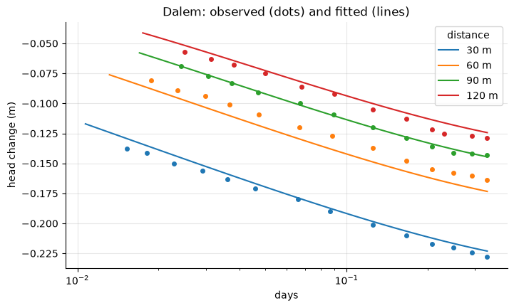
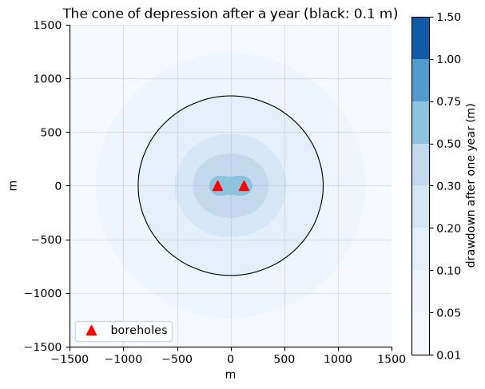

# Boreholes on real data: the Netherlands

[Interactive version on the KAI platform](https://hydro-saas.charkaks0.workers.dev/demo/reference/boreholes) · [Start free](https://hydro-saas.charkaks0.workers.dev/portal?plan=hydrosaas:free) · [All case studies](../README.md)

Three questions every borehole owner asks, each answered on real field data with open-source models.

| Notebook | Question | Tool | Result |
|---|---|---|---|
| [1 · Pumping tests](01_pumping_tests_ttim.ipynb) | What is the aquifer like? | TTim | Oude Korendijk: T = 463 m²/day, S = 1.8×10⁻⁴ (same as AQTESOLV). Dalem: T = 1,677 m²/day, c = 331 days (leaving one well out gives 183–351 days, and *c* is not identifiable without the 30 m well) |
| [2 · Borehole model](02_borehole_model_modflow6.ipynb) | How far will my boreholes draw down? | MODFLOW 6 (FloPy) | Rebuilds the Dalem test with RMSE 1.4–9.2 mm per observation well; two boreholes 250 m apart at 1,500 m³/day each, after one year: 1.38 m aquifer drawdown at each borehole cell, 13 % of it caused by the neighbour |
| [3 · Pumping or weather?](03_pumping_or_weather_pastas.ipynb) | Is the level falling because of us or the weather? | Pastas | Fitted to 1960–1999, predicted 2000–2015 to 0.22 m (RMSE of monthly means; weather alone: 0.77 m); the well fields held the level 6.0 m down at the 1991 peak |

## The data

* **Two classic field pumping tests** from Kruseman & De Ridder (1990), *Analysis and Evaluation of Pumping Test
  Data*, ILRI Publication 47: **Oude Korendijk**, a confined sand-and-gravel aquifer 7 m thick under 18 m of
  clay, pumped at 788 m³/day for about 14 hours; and **Dalem**, a leaky aquifer 37 m thick under an 8 m
  confining layer, pumped at 761 m³/day for 8 hours. Readings as digitised in the TTim documentation (MIT).
* **A 55-year groundwater-level record** (1960–2015) from an observation well with four public-supply well
  fields nearby, with daily rainfall and evaporation and monthly pumping: the Pastas documentation (MIT).

Notebooks 1 and 3 use no synthetic data: every model is fitted to the real readings. In notebook 2, MODFLOW 6
first reproduces the real Dalem test; the two-borehole layout after it is a clearly labelled what-if. Full sources and checksums: [DATA.md](../DATA.md).

## Method in brief

1. **TTim** (analytic elements, Mark Bakker) fits hydraulic conductivity, specific storage and, for Dalem, the
   resistance of the confining layer, by least squares on all observation wells. Each well is then left out
   in turn and predicted from the others: the honest accuracy.
2. **MODFLOW 6** models the Dalem aquifer as one layer with leakage through a general-head boundary in every cell
   (the Hantush assumption), on a grid of 1 m cells at the boreholes growing to 250 m, out to 5 km.
3. **Pastas** fits a transfer-function noise model: recharge (rain minus a fitted fraction of evaporation, Gamma
   response) plus one Hantush response per well field, with an autoregressive noise model. The blind test fits
   1960–1999 only and predicts 2000–2015.

## Limits

* Pumping tests of 8–14 hours constrain transmissivity well and leakage less well; the leakage resistance *c* at
  Dalem is the least certain number, and the reason longer tests are worth paying for.
* The drawdown from the borehole model is the aquifer drawdown in the 1 m cell that holds the borehole; the level
  inside a real borehole is lower by the well-radius correction (about 0.1 m here) and the well's own losses.
* The borehole model is single-layer and homogeneous. A real wellfield model adds the actual layering, boundaries
  and pumping schedules, and is checked again against the operator's own logger data.
* The 55-year record is from one observation well; the split between well fields is a statistical attribution,
  clearest for the well field with the strongest effect (well field 1).

## Compared with the KAI engine

Each notebook ends with a table comparing its numbers with `results/kai_engine_results.json`, the KAI engine's
published result for this case, and stops with an error if they drift apart. They agree. (The engine's run used
MODFLOW 6.6.0; newer releases give the same numbers.)

---

**On the KAI platform:** [Boreholes case](https://hydro-saas.charkaks0.workers.dev/demo/reference/boreholes) ·
[HydroSaaS](https://kai-water.charkaks0.workers.dev/hydrosaas.html) (borehole drawdown warnings for industrial parks) ·
[GroundWater Analyst](https://kai-water.charkaks0.workers.dev/groundwater-analyst.html) (3D groundwater models) ·
[Ask for a borehole study](https://kai-water.charkaks0.workers.dev/contact.html)
