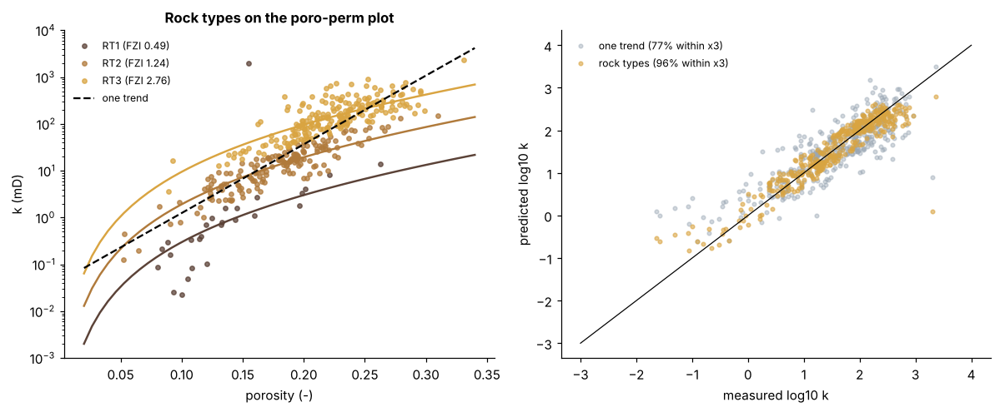
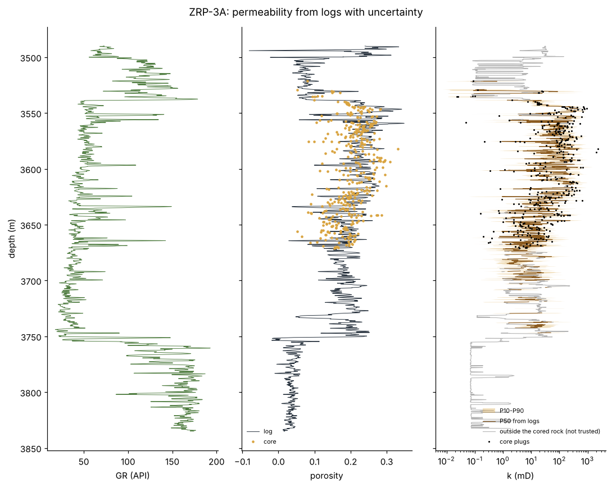
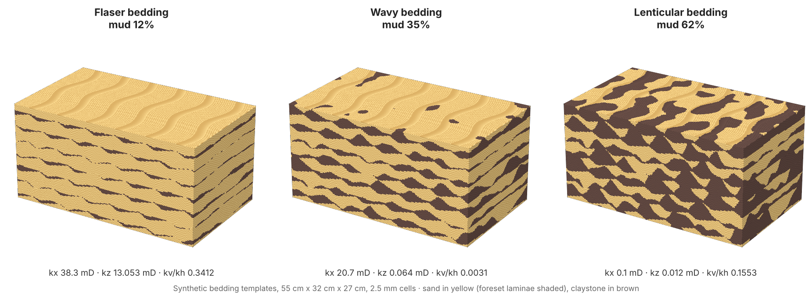
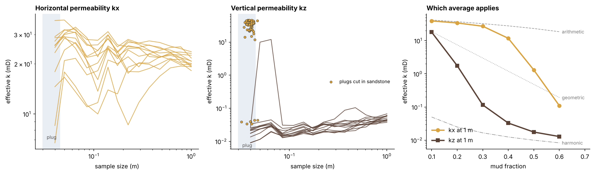

# Groningen Rotliegend core: rock typing, permeability from logs, and the scale problem

**KAI-Subsurface and KAI-GeoEnergy, tested in the open on public Dutch data.**

Well **ZEERIJP-03-SIDETRACK1 (ZRP-3A)** was drilled by NAM in 2015 into the Rotliegend (Slochteren) sandstone of
the Groningen gas field and cored over 199.8 m. Its core analysis and logs are public on
[NLOG](https://www.nlog.nl), the Dutch subsurface portal. These notebooks run three KAI workflows on it:

| Notebook | Question | Key result |
|---|---|---|
| [1 · Core QC and rock typing](01_core_qc_rock_typing.ipynb) | Do a few rock types predict permeability better than one porosity–permeability trend? | **96 %** of 409 plugs within a factor of 3 with three FZI rock types, against **77 %** with one trend |
| [2 · Permeability from logs, tested blind](02_permeability_from_logs_blind_test.ipynb) | Without core, how well do logs predict permeability? | With each core hidden in turn: **60 %** within a factor of 3, **93 %** within a factor of 10; rock types predicted from logs do not help at log resolution. A permeability log with P10–P90, marked where the rock is unlike anything cored |
| [3 · Bedding, REV and upscaling](03_bedding_rev_upscaling.ipynb) | At what scale does permeability become representative, and how wrong are plugs for vertical flow? | Plugs show kv/kh ≈ **1**; ripple-bedding models calibrated on the same plugs give **0.003–0.05** at 1 m for 20–40 % mud. Plugs cut in sandstone, as a laboratory cuts them, overstate bed-scale vertical permeability **20 to 1,200 times** |

**Try it in the browser:** the [KAI Plug-to-Block Lab](https://kai-water.charkaks0.workers.dev/plug-to-block-lab) runs the same bedding generator and flow solver in a web page. It drills virtual plugs and whole cores, and shows which sample size gives a vertical permeability you can trust.

## Data

* **Core analysis:** *Final Core Analysis data ZRP-3A* (NAM, 28 Jul 2015): routine plugs (porosity, Klinkenberg
  permeability, grain density, description), SCAL, petrography and geomechanics plug sets. NLOG document 3484333644.
* **Logs:** density, neutron, photoelectric, gamma ray, induction (run `mdn_mpd_mai_18aug15`) and sonic
  (`cxd_18aug15`), 3480–3872 m. NLOG log documents 2085821327 and 2085820326.

The files are published by the Dutch government on NLOG under the Mining Act and can be downloaded free of charge. They
are **not copied into this repository**: each notebook downloads them from NLOG on first run (into `nlog_cache/`)
and stops if a file's SHA-256 differs from the one listed in [DATA.md](../DATA.md). Source: NAM / NLOG.

## Method

`subsurface_tools.py` holds the shared functions (MIT licence):

* plug quality control: plugs described as fractured, broken or cracked are set aside; values below the 0.01 mD
  detection limit are counted, not fitted;
* reservoir quality index and flow zone indicator (Amaefule et al., 1993); rock types as a Gaussian mixture on
  log(FZI), with the Bayesian information criterion as a guide;
* blind test: leave one core out; one trend, rock types from logs (random forest), and a random forest on the logs;
* bedding models: two-component sand/mud sections with anisotropic lenses, from flaser to lenticular bedding;
* flow-based upscaling: effective kx and kz from a two-point-flux pressure solution with no-flow sides; REV from the
  variation between realisations as the window grows (after Nordahl and Ringrose, 2008).

## Limits

* One well. Rock types and the log model should be retrained on each field's own cores.
* Log resolution (about 0.5 m) cannot see centimetre laminae, which is why rock types do not transfer through the
  logs here. Image logs or core-calibrated bedding models (notebook 3) are the way to carry them.
* The bedding models are 2D and two-component; their numbers show the scale effect, not this well's exact kv/kh.

## What this becomes in KAI

* **KAI-Subsurface:** rock typing and permeability prediction for uncored wells, with honest uncertainty.
* **KAI-GeoEnergy:** core-calibrated bedding models and flow-based upscaling, so storage and geothermal models keep
  the heterogeneity that controls vertical flow and pressure.

*References:* Amaefule, J.O. et al. (1993) SPE 26436 · Nordahl, K. and Ringrose, P.S. (2008) Mathematical
Geosciences 40, 753–771 · Ringrose, P.S. et al. (2003) Petroleum Geoscience 9, 13–23.
