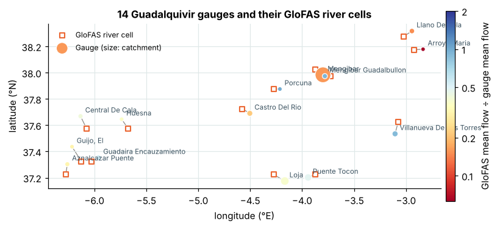
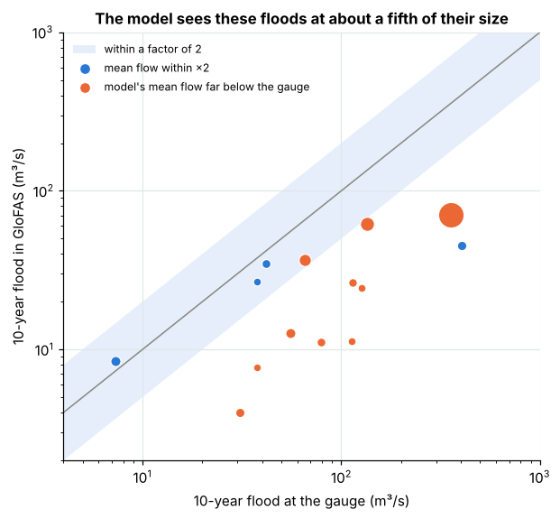
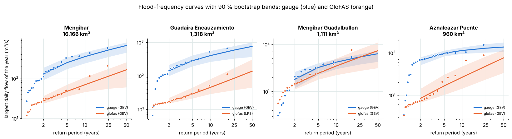
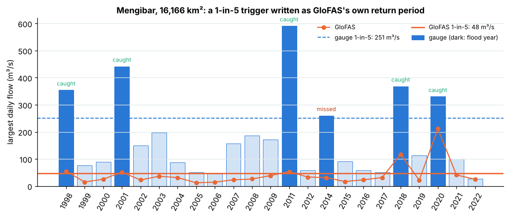
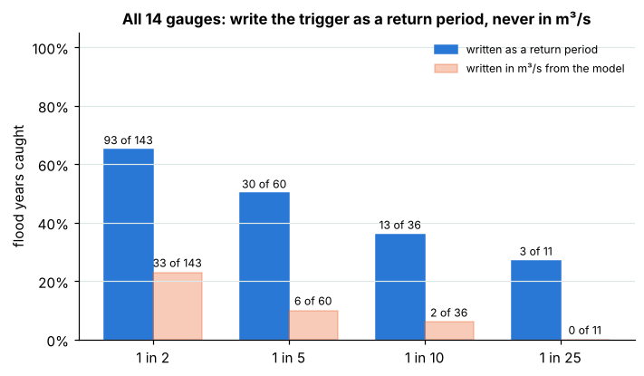

# Can a global flood model set a flood trigger where there is no gauge?

**KAI-Hydro parametric flood triggers, tested in the open on 14 river gauges in Spain's Guadalquivir basin.**

A parametric flood policy pays when a river index crosses an agreed trigger. Where a river has no gauge, the index
has to come from a global flood model. This case sets triggers from the GloFAS global flood reanalysis as if no gauge
existed, and scores them year by year against what 14 real gauges measured: the flood years the policy would have
paid, the ones it would have missed, and the payouts in years without a flood.

| Notebook | Question | Key result |
|---|---|---|
| [1 · Global model against the gauges](01_global_model_flood_triggers.ipynb) | How big is a 10-year flood in the model, and would a trigger set from it pay in the right years? | The model's 10-year flood is **22 %** of the gauged one (median). At 1-in-5, a trigger written in m³/s from the model caught **6 of 60** flood years; the same trigger written as the model's own return period caught **30 of 60**, with 27 false payouts |

**Interactive version, with a map to pick a forecast point:** [kai-water.charkaks0.workers.dev/case-guadalquivir](https://kai-water.charkaks0.workers.dev/case-guadalquivir) ·
[trigger explorer on the KAI-Hydro page](https://kai-water.charkaks0.workers.dev/kai-hydro#triggers)

## Paper, report and how to cite

* **Research paper:** [paper/paper.pdf](paper/paper.pdf), Kakooza, C. (2026), *Writing parametric flood triggers from a
  global flood model: a gauge-by-gauge test in the Guadalquivir basin, Spain*, version 1.0.
* **Technical report for insurers, brokers and risk pools:** [paper/technical_report.pdf](paper/technical_report.pdf)
  (KAI-Hydro KH-TR-2026-01), with every return level and the 1-in-5 trigger at every gauge.
* Every number in both comes from the files here: `paper/paper_stats.py` recomputes the statistics and
  `paper/build_documents.py` builds the documents from them ([paper/README.md](paper/README.md)).
* Cite with [CITATION.cff](CITATION.cff). Licence and source credits: [LICENCE.md](LICENCE.md) (text, figures and
  derived data CC BY 4.0; code MIT).

## Results

| | All 14 gauges |
|---|---|
| Model's mean flow ÷ gauge's (median) | 0.38 (within a factor of 2 at 4 gauges) |
| Model's 10-year flood ÷ gauge's (median) | 0.22 |
| Rank correlation of annual floods (median) | 0.42 |
| 1-in-5 trigger as the model's return period: caught / missed / false payouts | **30 / 30 / 27** |
| 1-in-5 trigger in m³/s from the model: caught / missed / false payouts | 6 / 54 / 10 |

Per gauge, per return period: [`results/return_levels.csv`](results/return_levels.csv) (levels with 90 % bands) and
[`results/trigger_scores.csv`](results/trigger_scores.csv) (1-in-2 to 1-in-25, both ways of writing the trigger).

**What it means.**
* The global model runs low in this dammed, irrigated, semi-arid basin. A search up to 25 km round the largest gauge
  found no bigger river cell, so it is the model, not the cell.
* Never write a trigger in m³/s straight from a global model; write it as the model's own return period.
* Even then, the basis risk is too high to sell on the global model alone. A contract needs local calibration on a
  gauge, satellite flood maps or local flood records.

## Data

* **Gauges:** *Anuario de Aforos 2021-2022*, Guadalquivir basin, from CEDEX (Centro de Estudios y Experimentación de
  Obras Públicas) for Spain's Ministry for the Ecological Transition and the Demographic Challenge (MITECO):
  `estaf.csv` (stations) and `afliq.csv` (daily mean flow). The files are **not copied into this repository**:
  `rebuild_data.py` downloads them from CEDEX on your own connection and stops if a file's SHA-256 differs from the
  one in [DATA.md](../DATA.md). *Fuente: CEDEX, Anuario de Aforos 2021-2022 (MITECO).*
* **Global model:** GloFAS reanalysis, LISFLOOD, consolidated, version 4.0, from the Copernicus Emergency Management
  Service, through the [Open-Meteo flood API](https://open-meteo.com/en/docs/flood-api) (data CC BY 4.0; the free API
  is for non-commercial use). *Contains modified Copernicus Emergency Management Service information 2026.*
* **In this repository:** only derived values: each water year's largest daily flow at each gauge and at its GloFAS
  cell ([`data/annual_maxima.csv`](data/annual_maxima.csv), 286 gauge-years) and the gauge list with catchment area,
  position and matched cell ([`data/gauges.csv`](data/gauges.csv)).

## Method

`flood_tools.py` holds the shared functions (MIT licence):

* gauges with a catchment of at least 500 km² and at least 25 years of daily flow in water years 1985–2022;
* the GloFAS cell within 0.1° whose mean flow is closest to the gauge's (a best case: it uses the gauge);
* annual maxima by water year (October–September), years with at least 80 % of days, years both sources cover;
* GEV and log-Pearson III fitted by L-moments (Hosking and Wallis, 1997), the better fit by probability-plot
  correlation (Gringorten positions), and a 90 % percentile bootstrap band (300 resamples) on each return level;
* a flood year is one in which the gauge passed its own 1-in-T level; a return-period trigger pays when the model
  passes its own 1-in-T level, a fixed-flow trigger when it passes the gauge's level in m³/s.

The notebook ends by checking its numbers against the KAI engine's published results
([`results/kai_engine_results.json`](results/kai_engine_results.json)): the trigger scores must match exactly and
the median ratios within 0.02.

## Limits

* One basin, strongly regulated by dams and irrigation; other basins will behave differently.
* GloFAS 4.0. The same test on GloFAS 5.0 (1980 to today) from the Copernicus Early Warning Data Store comes next.
* Annual maxima of daily means: instantaneous peaks are higher.
* 17 to 24 years per gauge, so levels beyond 1-in-25 are extrapolations and their bands are wide.
* The cell choice uses the gauge's mean flow; at an ungauged site the cell is chosen by catchment area.

## What this becomes in KAI

**KAI-Hydro, parametric flood triggers.** Pick a point on the map; KAI moves it onto the river by catchment size,
pulls the GloFAS 5.0 flood history, fits return levels with their bands, writes the trigger four ways (fixed flow,
percentile, return period or share of a reference flood, with attachment and exhaustion) and shows its hits, misses
and false payouts before the policy is written. Engineers get the same study as design floods.
[Parametric flood triggers](https://kai-water.charkaks0.workers.dev/solution-parametric-triggers) ·
[KAI-Hydro](https://kai-water.charkaks0.workers.dev/kai-hydro) · [Start free](https://hydro-saas.charkaks0.workers.dev/portal?plan=kaihydro:free)

*References:* Hosking, J.R.M. and Wallis, J.R. (1997) *Regional Frequency Analysis: An Approach Based on L-Moments*,
Cambridge University Press · Harrigan, S. et al. (2020) GloFAS-ERA5 operational global river discharge reanalysis
1979–present, *Earth System Science Data* 12, 2043–2060 · CEDEX (2024) *Anuario de Aforos 2021-2022*, MITECO.
