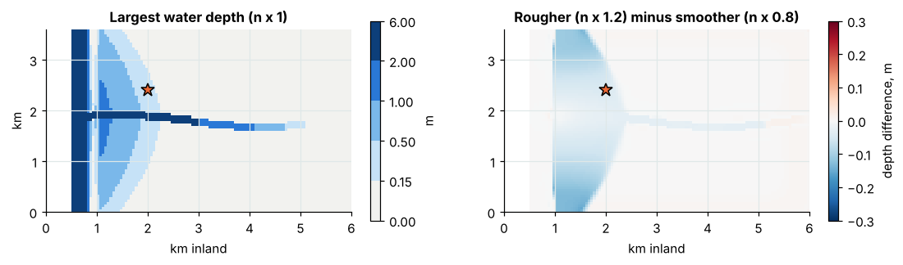

# Flood maps in seconds: a SFINCS ensemble on a test valley

**KAI-River · KAI-Hydro · fast flood maps** · [Notebook](01_sfincs_flood_ensemble.ipynb) · [KAI-River](https://www.kaiwaterenergy.com/kai-river) · [KAI-Hydro](https://www.kaiwaterenergy.com/kai-hydro)

**Question.** A storm surge and a two-hour rain burst arrive together on a coastal valley. Where does the water go,
how deep does it get, and how much does the answer move when the ground's roughness (Manning's n), a parameter nobody
measures well, is uncertain?

## Why it matters
* **Flood warning (KAI-Hydro).** A forecast becomes useful when it becomes a map. SFINCS turns water levels and rain
  into depth maps fast enough to run many members of a forecast.
* **Urban and rain-on-grid flooding.** SFINCS takes rain directly on every cell, so the same set-up maps flooding from
  rain in towns and on floodplains, not only from rivers and the sea.
* **Parametric flood triggers.** A trigger read from a flood map (say, the flooded area of a district) carries the
  model's own uncertainty. An ensemble shows how much of the basis risk comes from the model.

## Model and data
* **Model:** [SFINCS](https://github.com/Deltares/SFINCS) (Super-Fast INundation of CoastS) v2.5.0, developed by
  Deltares and published as open source under GNU GPL-3.0. KAI builds it from that source code in its own container
  and runs it unchanged. This repository holds no SFINCS code or programs. KAI is not affiliated with Deltares.
* **Data:** none from outside. The valley is **synthetic**, generated by the KAI engine: 6 km x 3.6 km of 50 m cells,
  a sea strip with a water-level boundary, a beach and dune, a coastal plain and a meandering river channel. It is not
  a real place. The storm: a 0.6 m tide with a 1.8 m surge peaking at 14 h, and 30 mm/h of rain from 10 h to 12 h.
* **Ensemble:** five runs, identical except that every Manning's n is multiplied by 0.8, 0.9, 1.0, 1.1 or 1.2.

## Results (simulated)

| n factor | Flooded valley floor (depth > 0.15 m) | Largest depth on the floor | Peak level at the reporting point |
|---|---|---|---|
| 0.8 | 3.44 km² | 1.14 m | 1.57 m |
| 0.9 | 3.37 km² | 1.14 m | 1.56 m |
| 1.0 | 3.29 km² | 1.14 m | 1.55 m |
| 1.1 | 3.22 km² | 1.13 m | 1.54 m |
| 1.2 | 3.14 km² | 1.13 m | 1.52 m |

* Smoother ground lets the surge run further inland: the flooded area moves by **9 %** across the members from
  roughness alone, while the largest depth barely moves (the low ground behind the dune fills either way).
* For a trigger on flooded area, a level near the middle (3.25–3.30 km²) pays in 2 or 3 of the 5 members: the model's
  roughness alone can decide a payout. Calibrate n on a past flood, or set the trigger with the band in view.
* Checks: SFINCS finished for every member; no invalid depths; no level above what the sea and rain can explain; on a
  closed basin with known rain, stored water matches the rain to **0.18 %**.
* Five members in about **26 s** on one laptop (engine queue to finished map: about 73 s).

The notebook reads the model's input files and the members' outputs, and stops if its flooded areas differ from the KAI
engine's published results (`results/kai_engine_results.json`).

## Limits
* Synthetic: nothing here describes a real place or a real flood.
* One storm and one uncertain parameter; real uncertainty also comes from the forcing, the terrain and, in towns,
  buildings and drains.
* No infiltration (`qinf = 0`) and 50 m cells. For real sites KAI builds SFINCS models from a terrain model with
  HydroMT-SFINCS, the next step.

## Files
* `data/model/`: the SFINCS input files of the n x 1 member (binary regular grid: `sfincs.ind/.msk/.dep/.man`; text:
  `sfincs.inp`, `sfincs.bnd/.bzs` sea level, `sfincs.prcp` rain, `sfincs.obs` reporting point).
* `results/members/`: each member's `sfincs_map.nc` (largest depth and level) and `sfincs_his.nc` (level at the point).
* `results/hmax_middle_member.tif`: the n x 1 depth map as a Cloud-Optimised GeoTIFF in local metres (no projection).
* `results/kai_engine_results.json`: the KAI engine's result, the same file the platform shows.

## Run it yourself
Run the notebook as described in the [repository README](../README.md). To rerun the model, build SFINCS from
[its source](https://github.com/Deltares/SFINCS) and run it in a copy of `data/model/`; for another member, multiply
the float32 values in `sfincs.man` by its factor.

See [LICENCE.md](LICENCE.md).
