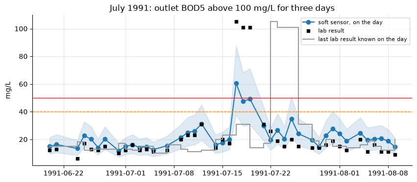

# Effluent BOD soft sensor on real treatment-plant data

[Interactive version on the KAI platform](https://hydro-saas.charkaks0.workers.dev/demo/reference/soft-sensor) · [Start free](https://hydro-saas.charkaks0.workers.dev/portal?plan=hydrosaas:free) · [All case studies](../README.md)

**Notebook:** [Effluent BOD on the day, not five days later](01_bod_soft_sensor.ipynb)

Outlet BOD5 is the compliance number, and it takes five days in the laboratory. A soft sensor estimates it on the
day from a fast measurement, here outlet suspended solids (which a turbidity/TSS probe reads continuously), and
keeps learning as each lab result arrives.

## Results: 1991 blind test

**This notebook** (224 lab days with both outlet BOD5 and TSS):

| Estimate on the day | Typical error (MAE) | Within 25 % | Days above 40 mg/L flagged | False alarms |
|---|---|---|---|---|
| Soft sensor, TSS only | 4.4 mg/L | 69 % | 3 of 3 | 1 |
| Last lab result known (5+ days old) | 7.4 mg/L | 52 % | 0 of 3 | 4 |
| Typical value (median of known results) | 5.5 mg/L | 61 % | 0 of 3 | 0 |

**KAI engine** (226 lab days; it also chooses the model form on 1990 only and tests richer probe sets):

| Inputs | Typical error (MAE) | Within 25 % | Days above 40 mg/L flagged |
|---|---|---|---|
| TSS probe | 4.4 mg/L | 69 % | 3 of 3 |
| TSS probe + 2-hour COD | 4.3 mg/L | 66 % | 3 of 3 |
| Last lab result | 7.5 mg/L | 52 % | 0 of 3 |
| Typical value | 5.5 mg/L | 61 % | 0 of 3 |

The 90 % band contained the lab value on 88 % of days.

**The July 1991 event.** On 17–19 July outlet BOD5 was 101–105 mg/L. The soft sensor rose above the 40 mg/L warning
level on all three days, while the last known lab result still read 14–31 mg/L. It underestimated the event (about
47–61 mg/L), crossed the 50 mg/L limit on only one day, and the lab value fell outside its band on the last two
days. The three days above 40 mg/L are this one event. A soft sensor tells you when to call the lab; it does not
replace it.

## The data

UCI Machine Learning Repository, *Water Treatment Plant* (dataset 106, [doi:10.24432/C5FS4C](https://doi.org/10.24432/C5FS4C)):
527 days (January 1990 to October 1991) of daily measurements at the inlet, settlers and outlet of an urban
wastewater treatment plant. Creator Manel Poch (Universitat Autònoma de Barcelona); donors Javier Béjar and Ulises
Cortés (Universitat Politècnica de Catalunya). CC BY 4.0. No synthetic data: every estimate is checked against the
real lab result.

## Method in brief

Walk forward one sampled day at a time. On day *t* the model may only use lab results dated five days or more
before *t*; it is refitted weekly as log(BOD) against log(1 + TSS), with Duan's smearing correction; its 90 % band
comes from its own earlier out-of-sample errors. April–December 1990 warms it up; 1991 is the test.

## Limits

* In this plant outlet suspended solids was a laboratory measurement; the case assumes a modern plant reads it
  continuously with a turbidity/TSS probe.
* One plant, 22 months, one high-BOD event in the test year; a soft sensor is retrained on each plant's own lab
  history and keeps the lab as the reference.

---

**On the KAI platform:** [Soft-sensor case](https://hydro-saas.charkaks0.workers.dev/demo/reference/soft-sensor) ·
[Factory compliance demo](https://hydro-saas.charkaks0.workers.dev/demo) ·
[Effluent compliance](https://kai-water.charkaks0.workers.dev/solution-effluent-compliance.html) ·
[Talk to us](https://kai-water.charkaks0.workers.dev/contact.html)
