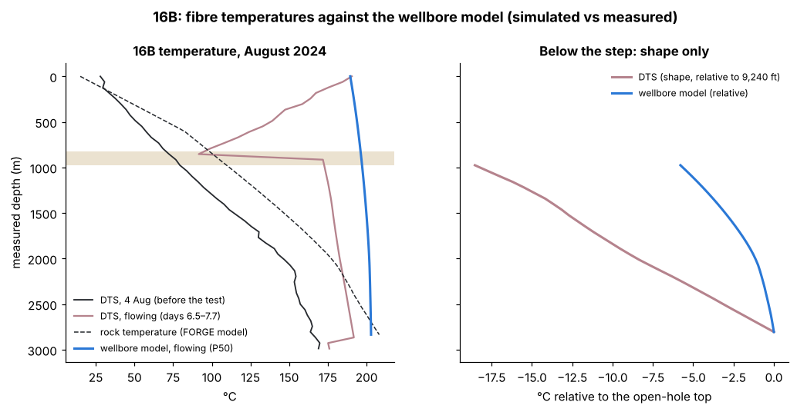
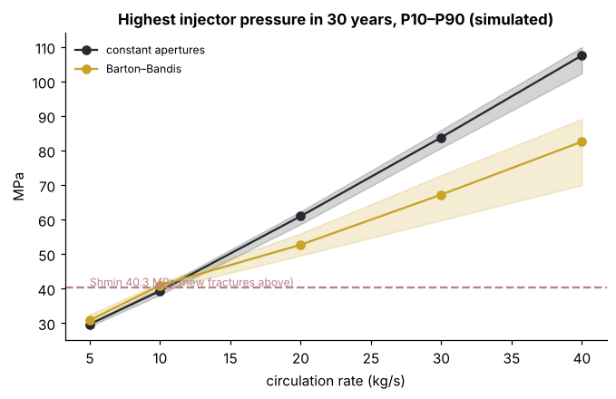
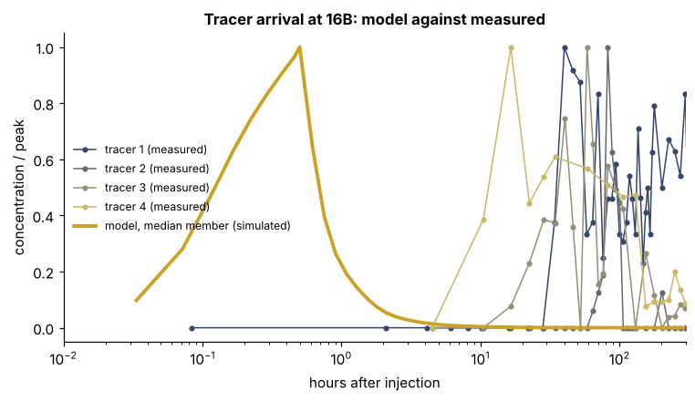
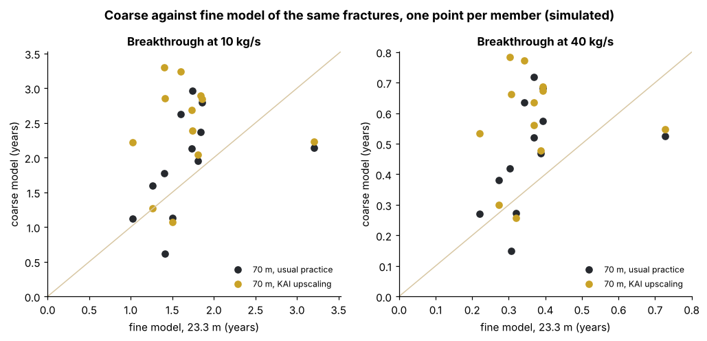
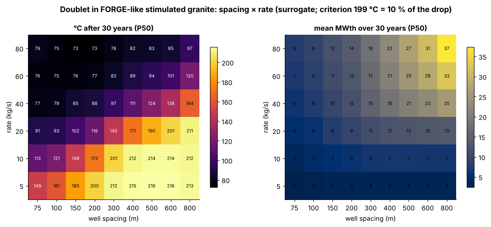

# Utah FORGE: what a geothermal well pair in hot granite will deliver

**KAI-GeoEnergy · KAI Reservoir Lab · tested in the open on public U.S. Department of Energy data.**

Utah FORGE is the U.S. Department of Energy's field laboratory for enhanced geothermal systems (EGS), near Milford,
Utah: hot granitoid under basin fill, deep deviated wells, stimulation and circulation tests. Its data are public on
the DOE Geothermal Data Repository (GDR) under CC BY 4.0. This case builds the site model in the KAI Reservoir Lab and
asks the question a geothermal client pays for: *what will a well pair deliver over 30 years, with an honest P10–P90?*

| Notebook | Question | Key result |
|---|---|---|
| [1 · Structure and temperature](01_structure_and_temperature.ipynb) | Where is the hot granitoid, how hot is it, and does the 3-D temperature model hold at the deep well? | The granitoid lies **533–1,911 m** below ground across the 2.5 × 2.5 km site and **985 m** at well 58-32. The temperature model matches the 2018 log of 58-32 to **1.7 °C** RMSE (bias +1.4 °C; not a blind test). **7.9 km³** of granitoid is hotter than 175 °C inside the model volume |
| [2 · Fractured granite ensemble](02_fractured_granite_ensemble.ipynb) | What do the 58-32 image log and the FORGE fracture models say, and what survives the 2024 circulation test? | The FMI log gives **3.65 fractures/m** (P32 ≈ **11 m²/m³** with the reference-DFN orientations). Taken as in-situ apertures, the FMI apertures make the well pair **72 ×** easier to circulate than measured. Calibrated on the August 2024 test, the stimulated fractures carry about **0.13 ×** (P10–P90 0.06–0.15) the apertures of the 2024 DFN |
| [3 · A well pair over 30 years](03_doublet_30_years.ipynb) | What would 16A(78)-32 / 16B(78)-32 deliver at 10–80 kg/s for 30 years? | Not fitted, the model predicts the August 2024 recovery (**94 %**, P10–P90 91–96 %, measured 93 %) but not the produced temperature (+13 °C after a wellbore estimate) or the April test. Only **10 kg/s** stays pressure-feasible: produced temperature **214 → 130 °C** (P10–P90 116–148) in 30 years, heat **6.4 → 2.9 MWth**, thermal breakthrough after **1.35 ± 0.11 years** (grid-converged, median member; ensemble 0.9–2.6 years on 35 m cells, about 25 % late). *Simulated* |
| [4 · Upscaling check](04_upscaling_check.ipynb) | Does the full tensor, or a coarse 70 m model, change the answer? | The full tensor moves breakthrough by **+8 %** (35 m cells) and **−1 %** (23.3 m). A 70 m model of the same fractures makes breakthrough late by **+25 %** (P10–P90 −32 to +62 %) the usual way and **+54 %** (−26 to +115 %) with KAI upscaling; KAI upscaling keeps the 30-year temperature within **2.4 °C** (usual: 10.8 °C) and the August pressure within 19 % without recalibration (usual: 37 %). Grid-converged breakthrough at 10 kg/s: **1.26 ± 0.13 years**. *Simulated* |
| [4b · Wellbore, apertures, tracers](04b_wellbore_tracers.ipynb) | How much of the temperature misfit does a wellbore model explain? Do pressure-dependent apertures allow higher rates? Do travel times match the tracers? | The wellbore model explains **2 °C** of the 13 °C misfit; **+11.2 °C** (9.7–12.6) remains, and the 16B fibre shows 3 × more cooling up the hole than conduction allows. With Barton–Bandis apertures **no rate above 10 kg/s becomes feasible** under Shmin (highest **9.7 kg/s**, 9.3–10.5). Modelled tracers arrive in under 30 minutes; measured ones took **4.5–64 hours**: the model's mobile pore volume is at least 17–360 × too small. *Simulated* |
| [5 · Decision chart](05_decision_chart.ipynb) | What spacing would a 30-year doublet need? | **This well pair is a test bed, not a power plant.** To keep the produced temperature within 10 % of its drop for 30 years, a doublet in this kind of stimulated granite needs about **290 m at 10 kg/s** and **580 m at 20 kg/s** (P50; 96 m now), and more than 800 m at 40 kg/s. Surrogate error 9.0 °C RMSE on held-out runs; the answer is checked with full runs. *Simulated / surrogate* |

## Data

All from the GDR, CC BY 4.0 (details and DOIs in [LICENCE.md](LICENCE.md)):

* **3-D model export** (GDR 1205): lithology (granitoid / basin fill) on 137,500 cells of 50 m, and temperature,
  pressure and depth at 145,656 nodes, from Seequent Leapfrog Geothermal.
* **Well 58-32 temperature log**, 8 November 2018 (GDR 1101).
* **Surveyed well heads**, December 2021 (GDR 1358).
* **58-32 FMI fracture picks** (GDR 1299): depth and apertures of 147 fractures.
* **FORGE 2024 discrete fracture network** (GDR 1646, Finnila and Jones): the 16A(78)-32 / 16B(78)-32 trajectories, four
  natural-fracture sets (orientation, size) and the connected DFN of the stimulated reservoir.
* **2024 circulation tests**: the extended test of 8 Aug – 5 Sep 2024 (GDR 1683) and the 9-hour test of 27 April 2024
  (GDR 1611).
* **16B fibre temperatures (DTS)**, 4 Aug and 12–16 Aug 2024 (GDR 1721), and the **QuantumPro nanoparticle tracers** of
  the August 2024 test (GDR 1701).
* The SHmax direction (N25E, N10E–N40E) and the minimum-stress gradient are quoted from the FORGE stress summary in
  GDR 1222.

`data/` holds only derived values: `forge_model.npz` (granitoid flag, temperature, pressure and depth as float32; the
grid's map transform), `well_58_32_log_2018.csv` (the log every 5 m) and `wells.csv`; for notebooks 2 and 3
`fmi_58_32.csv`, `trajectories_16A_16B.csv` (every 10 m), `natural_fracture_poles.csv`, `stimulated_dfn.csv`,
`circulation_2024_aug_daily.csv` and `circulation_2024_summary.json`; for notebook 4b `dts_16B_2024.csv`,
`dts_16B_2024_deep.json` and `tracers_2024_circulation.csv`. `rebuild_data.py` downloads the
GDR files into `gdr_cache/`, checks their SHA-256 and rebuilds `data/` byte for byte.

## Method

`forge_tools.py` (MIT) holds the shared functions: the GDR download with checksum, the Leapfrog and LAS readers, the
local-to-UTM fit, the granitoid surface, interpolation along a well and isotherm depths. The KAI engine builds the same
model from the raw files on its own grid (`kai-engine reference forge`); its results are in
`results/kai_engine_results.json`, and notebook 1 stops if the two disagree.

Notebooks 2 and 3 show the KAI engine's fractured-granite runs (`kai-engine reference forge-pair`; results in
`results/kai_engine_phase3.json` and `results/forge_pair_fields.npz`). The fractures are an **equivalent continuum**:
each fracture adds its Oda permeability tensor to the cells it crosses (35 m cells, 1,050 × 630 × 630 m around the open
intervals). Natural fractures come from the FMI density with the reference-DFN orientations and sizes; the stimulated
network is the GDR 1646 connected DFN. Each of 20 ensemble members varies fracture density, natural aperture, set
orientation and the spread of stimulated apertures, and calibrates one factor on the stimulated apertures to the
August 2024 injection pressure. Flow and heat use a two-point-flux solver with flux-limited (TVD) heat advection.
Breakthrough times are checked on three grids (52.5, 35, 23.3 m) and quoted grid-converged with their error.
The notebooks recompute the data-derived numbers with `forge_tools.py` and stop if the engine disagrees or a published
number changes. All model numbers are **simulated**.

Notebooks 4, 4b and 5 show the phase 4 run (`kai-engine reference forge-phase4`; results in
`results/kai_engine_phase4.json`, the numbers each notebook asserts in `results/published_phase4.json`, built with
`make_notebooks4.py` and `make_published4.py`). Phase 4 adds a wellbore model (Hasan–Kabir heat loss, Colebrook
friction) for both wells, Barton–Bandis apertures for the stimulated fractures (closure with Shmin − p, no new
fractures), a tracer run in the fracture porosity, the full Oda tensor, a 70 m model upscaled from the 23.3 m one
(transmissibilities and well indices from the fine well-pair solution), and a proxy doublet tied to the FORGE ensemble
for the spacing × rate chart, with a Gaussian-process surrogate and Sobol indices.

## Limits

* The temperature model is the source's, not a KAI interpretation. 58-32 was used to build it, so the log comparison
  checks consistency, not predictive skill. Its accuracy away from the deep wells is not tested here.
* The stresses are the depth gradients defined in the source workbook, not a stress model.
* 50 m cells place the granitoid contact to ±25 m.
* Phase 3: equivalent continuum with a diagonal permeability per cell; fracture apertures do not change with pressure or
  temperature and no new fractures form, so rates above 10 kg/s are what-if results (not pressure-feasible); no wellbore
  model; single-phase water; one calibration test. See the limits at the end of notebooks 2 and 3.
* Phase 4: apertures respond to pressure but no new fractures form, and Shmin is a gradient, not a measurement at 16A;
  the tracers show the model's flow paths are far too short in volume; the wellbore model leaves +11 °C unexplained;
  the decision chart is a proxy that assumes a network of the same kind at a wider spacing. See the end of notebooks
  4, 4b and 5.

## What this becomes in KAI

The model is the starting point of the KAI Reservoir Lab's geothermal workflow: a fractured-granite ensemble, a 30-year
well-pair forecast with P10–P90, and an audit of how much coarse models change the answer.

*Credit: Utah FORGE, U.S. Department of Energy, via the Geothermal Data Repository (OpenEI), CC BY 4.0.*
